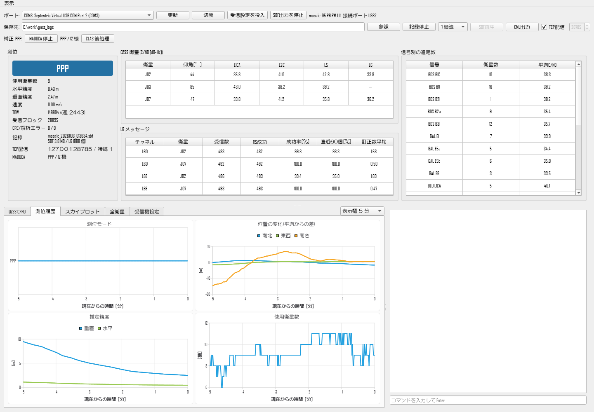
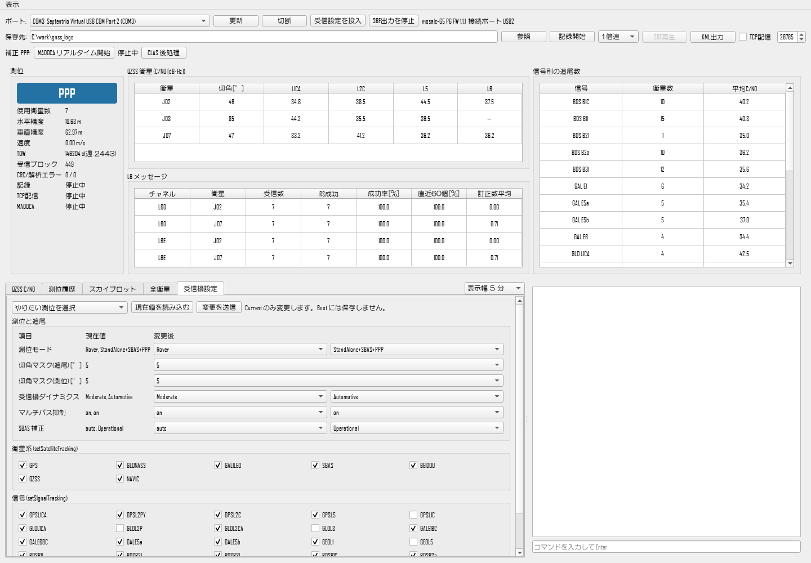
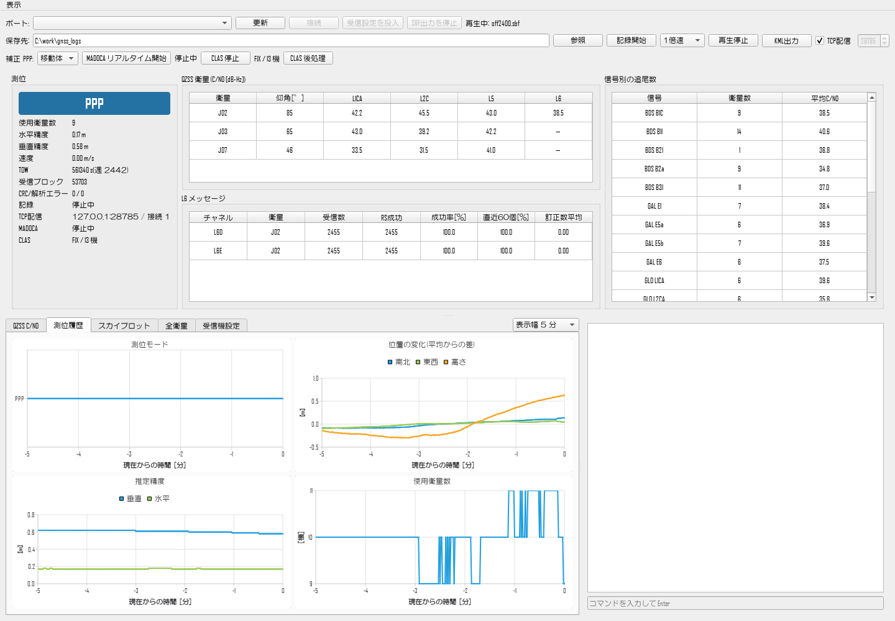

# mosaic_gnss_recorder

Septentrio mosaic 受信機に接続して、測位状況と QZSS L6 の受信状況を見ながらログを保存するツールです。

使える測位手法は次のとおりです。受信機内蔵のエンジンは「受信機設定」タブで切り替え、このソフトウェアのエンジン(MALIB・CLASLIB)は受信機の測位と並行して動かせます。

| 測位手法 | 受信機内蔵エンジン<br>リアルタイム | このソフトウェア<br>リアルタイム | このソフトウェア<br>後処理 |
|---|:---:|:---:|:---:|
| 単独測位 | ○ | | |
| SBAS | ○ | | |
| Galileo HAS PPP | ○ ※1 | | |
| RTK | ○ ※2 | | |
| MADOCA-PPP | | ○ ※3 | |
| CLAS(PPP-RTK) | | ○ ※3 | ○ ※3 |

※1 HAS 対応の受信機(Capabilities に PPPGalileoHAS-SIS があるもの)。
※2 基準局の補正データ(NTRIP など)を受信機へ別途入力する。
※3 QZSS L6 を受信できる受信機が必要。後処理は記録済みの SBF を使う(RxTools の sbf2rin で RINEX に変換する)。

操作方法と測位モードごとの使い方は [docs/manual.md](docs/manual.md)(PDF 版: [docs/manual.pdf](docs/manual.pdf))を見てください。



## インストーラ版を使う場合

### 用意するもの

- Windows 10 / 11 の PC
- Septentrio mosaic 受信機(mosaic-G5 / mosaic-X5 など)と USB ケーブル、GNSS アンテナ
- RxTools(Septentrio の Web サイトから入手)。**USB Driver 付きで**インストールする。
  Septentrio の USB ドライバと、CLAS 後処理で使う sbf2rin はこれに含まれる(このアプリには同梱していない)
- CLAS / MADOCA を使う場合: QZSS L6 を受信できる受信機とアンテナ

### インストール

1. [Releases](https://github.com/kijitora-no-hito/mosaic_gnss_recorder/releases) から
   `mosaic_gnss_recorder_Setup.exe` をダウンロードして実行する。管理者権限は不要
2. スタートメニューに mosaic_gnss_recorder が追加される

MADOCA / CLAS の測位エンジンも同梱しています。既定の保存先は「ドキュメント\\mosaic_gnss_recorder」です。
USB ドライバが無い場合、インストーラが案内を表示します。

## ソースからビルドする場合

### 用意するもの

| 用途 | 必要なもの |
|---|---|
| 実行 | Python 3.11、`pip install -r requirements.txt`(PySide6、pyserial)、RxTools(USB Driver 付き) |
| MADOCA / CLAS のエンジン | [MALIB](https://github.com/JAXA-SNU/MALIB) と [CLASLIB](https://github.com/QZSS-Strategy-Office/claslib) の clone、[MSYS2](https://www.msys2.org/) の ucrt64 gcc(`pacman -S mingw-w64-ucrt-x86_64-gcc`)。CLASLIB の `util\rnx2rtkp` は CLASLIB の手順で先にビルドしておく |
| インストーラ | PyInstaller、[Inno Setup 6](https://jrsoftware.org/isinfo.php) |

### 手順

1. 実行する(リポジトリのルートで)。エンジンが無くても、記録・表示・KML 出力は使える
   ```
   pip install -r requirements.txt
   python -m mosaic_gnss_recorder
   ```
2. MADOCA / CLAS のエンジンを作る。`engines\bin`、`engines\data`、`engines\licenses` にできる。
   MALIB・CLASLIB・MSYS2 の場所は既定で `C:\work\60_tools\MALIB`、`C:\work\60_tools\claslib`、`C:\msys64`。
   違う場所なら引数で指定する
   ```
   powershell -ExecutionPolicy Bypass -File engines\build_engines.ps1 -Malib <MALIB> -Claslib <CLASLIB> -Msys <MSYS2>
   ```
3. インストーラを作る。`packaging\Output\` にできる。エンジンが未作成なら 2. を自動で呼ぶ(既定の場所を使う)
   ```
   powershell -ExecutionPolicy Bypass -File packaging\build.ps1
   ```

## 使い方

1. ポートで **Virtual USB COM Port 1 または 2** を選び、[接続] を押す。
   機種と FW を自動で読み取るだけで、受信機の設定は変えない
2. [受信設定を投入] を押す。送るコマンドは次の 2 つ。Current だけを変更し、Boot には保存しない
   ```
   setSignalTracking,+QZSL6
   setSBFOutput,Stream10,<接続中のポート>,Rinex+RawNavBits+PVTGeod+Status+GALRawCNAV+QZSRawL6D+QZSRawL6E,sec1
   ```
   L6 に対応しない受信機(Capabilities に QZSL6 が無いもの)には、L6 に関する部分を除いて送る
3. 保存先を確認して [記録開始] を押す
4. 終わったら [記録停止]、[SBF出力を停止]、[切断] の順に押す

電源を入れ直すと、受信機は Boot の設定に戻ります。

右下の欄からは、任意のコマンドを送れます(`getPVTMode` など)。

## 受信機の設定

「受信機設定」タブで、現在の設定の確認と変更ができます。接続すると現在値を自動で読み出します。



- やりたい測位: Galileo HAS PPP、Galileo HAS PPP + L6 記録、単独測位、SBAS、RTK から選ぶと、
  関係する項目が選択済みになる。選んだだけでは受信機に送らない。RTK は補正データの入力が別途必要
- プルダウン: 測位モード、仰角マスク(追尾/測位)、受信機ダイナミクス、マルチパス抑制、SBAS 補正
- チェックボックス: 衛星系、信号。信号は受信機が対応するものだけ表示する

[変更を送信] を押すと、送るコマンドの一覧を確認したうえで、変更した項目だけを送り、値を読み直します。
変更されるのは Current だけで、電源を入れ直すと Boot の設定に戻ります。
衛星系や信号を変えると、追尾がいったん止まって再捕捉が始まります。
受信機が受け付けなかった場合は、タブの下にエラーを表示します。

## 保存されるファイル

| ファイル | 内容 |
|---|---|
| `mosaic_日時.sbf` | CRC 検査を通った SBF ブロック。sbf2rin で RINEX に変換できる |
| `mosaic_日時_pvt.csv` | 測位結果(測位モード、緯度経度、楕円体高、速度、衛星数、推定精度)。**位置情報を含む** |
| `mosaic_日時_L6D_Jnn.l6` | CLAS 用。RS 復号に成功したメッセージだけを 250 バイト単位で並べたもの |
| `mosaic_日時_L6E_Jnn.l6` | MADOCA-PPP 用。形式は同じ |

既存のファイルは上書きしません。

## KML 出力

[KML出力] で記録済みの SBF を選び(複数可)、保存先を指定すると、Google Earth などで開ける KML を作ります。
軌跡と各エポックの点を測位モードで色分けし、モードごとのフォルダに分けるので、表示を切り替えて確認できます。
点には時刻(JST)、測位モード、衛星数、推定精度が入ります。受信機とは通信しないので、記録中でも使えます。
位置の無いエポックは出力しません。**KML は位置情報を含みます。**

## TCP 配信

[TCP配信] にチェックを入れると、受信した SBF ブロック(CRC 検査を通ったもの)を、そのまま TCP で配信します。
COM ポートは 1 つのアプリしか開けないので、記録しながら別の測位ソフトで処理したいときに使います。

- 待ち受けは `127.0.0.1`(この PC 内)だけです。ポート番号は既定で 28785 です
- コマンドの応答文字列は送りません。受信機の設定は変えません
- SBF の再生中も配信するので、記録済みのデータをリアルタイムと同じように流せます
- 受け取り側が詰まって 1 MB 以上溜まった場合は、その接続を切ります

受け取り側の例(RTKLIB 系の入力ストリーム設定): 種類 TCP Client、アドレス `localhost:28785`、形式 SBF。
MADOCA-PPP の L6E を使う場合は、[受信設定を投入] で QZSRawL6E を出力しておきます。
このアプリの [MADOCA リアルタイム開始] / [CLAS リアルタイム開始] も、この配信を入力にしています。



`engines/clas_rt/clas_rt.c` は CLASLIB の後処理ルーチンに SBF の読み取り(MALIB から移植)と TCP 受信を足したものです。
補正の組が揃うのを待つため、観測を 5 秒遅らせて測位します。
`engines/malib_rt/septentrio.c` は MALIB の SBF デコーダの複製で、L6 を 1 衛星に絞り、RS 復号に失敗したフレームの後は
次のサブフレーム先頭まで捨てる処理を足しています(欠けたまま連結すると補正がずれるため)。
記録の `.l6` と CLAS 後処理用の L6D も、同じ規則で欠けを除いています。

## 実機なしで試す

[SBF再生] で記録済みの SBF を開くと、速度を選んで再生できます。
再生中に [記録開始] を押すと、SBF から .l6 を作れます。

## 表示

- 測位: 測位モード(色付きで大きく表示)、使用衛星数、推定精度、速度、受信ブロック数
- QZSS 衛星: 衛星ごとの仰角と L1CA / L2C / L5 / L6 の C/N0。「—」は未追尾
- L6 メッセージ: チャネル・衛星ごとの受信数、RS 復号の成功率、訂正シンボル数の平均
- 信号別の追尾数: 特定の帯域だけ受からない状況の切り分けに使う
- 下段のタブ:
  - QZSS C/N0: L6 と L1CA の時系列
  - 測位履歴: 測位モード、位置の変化(平均からの差)、推定精度、使用衛星数の時系列
  - スカイプロット: 追尾中の衛星の配置(探索中のチャネルは出さない)
  - 全衛星: 衛星ごとの方位・仰角と、帯域ごとの C/N0
- グラフの時間幅: タブ右上で 1 分 / 5 分 / 15 分 / 1 時間 / 全期間を選ぶ。
  全期間以外は右端が現在で、線が左へ流れる。全期間は記録開始からの経過時間で表示する
- 赤字: QZSL6 が無い受信機、観測量のスクランブル、L6 未受信

## 緯度経度と地図

「表示」メニューで切り替えます。起動時はどちらも OFF です。

- 緯度経度を表示: 測位欄に緯度、経度、楕円体高を出す
- 地図を表示: 地図タブを追加し、現在位置と軌跡を OpenStreetMap に重ねる

地図を ON にすると、Leaflet(unpkg.com)と地図タイル(tile.openstreetmap.org)をインターネットから取得します。
タイルの要求から、表示している場所の概略が地図サーバに伝わります。OFF の間は接続しません。

## 構成

| ファイル | 役割 |
|---|---|
| `sbf_parser.py` | SBF の分離(CRC 検査)とデコード |
| `state.py` | 集計 |
| `logger.py` | ファイル保存 |
| `kml_export.py` | SBF から KML への変換 |
| `tcp_server.py` | SBF の TCP 配信 |
| `engines.py` | MADOCA / CLAS リアルタイム(malib_rt / clas_rt)と CLAS 後処理(CLASLIB)の実行 |
| `serial_link.py` | COM ポートの入出力、再生、コマンド送信 |
| `settings.py` | 受信機設定の解析、コマンドの組み立て、設定画面 |
| `charts.py` | グラフとスカイプロット |
| `map_view.py` | 地図 |
| `app.py` | GUI |

テストは `test/test_mosaic_gnss_recorder.py` です。
