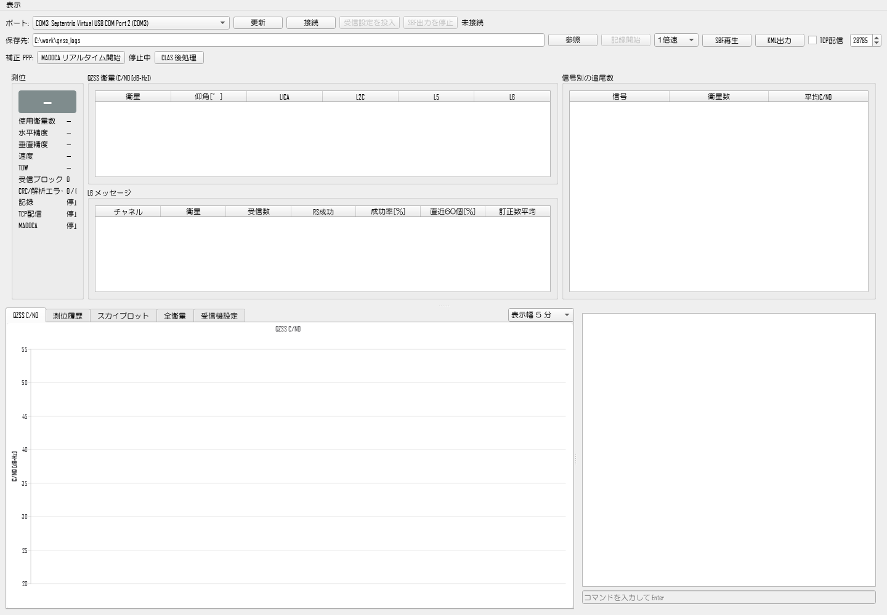
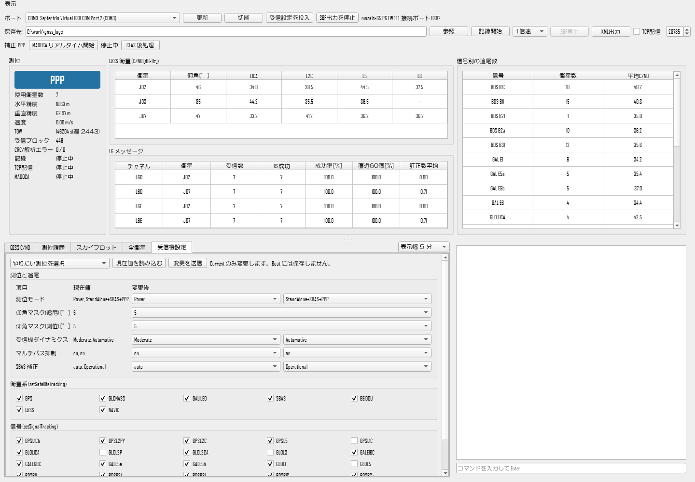
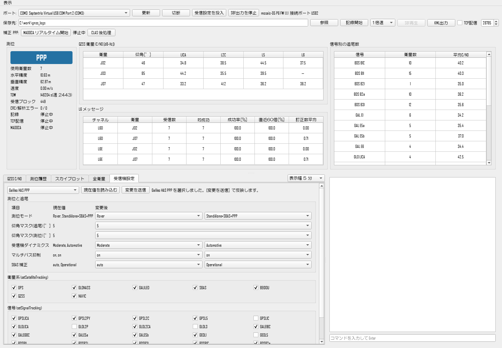
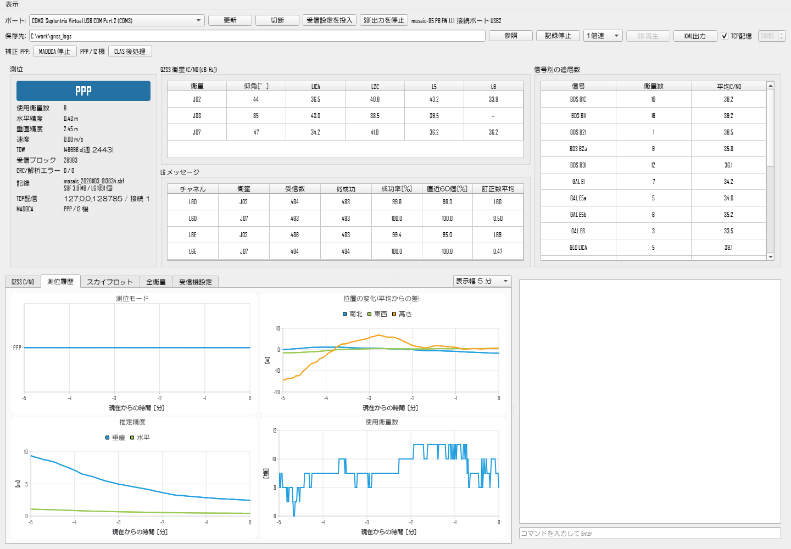
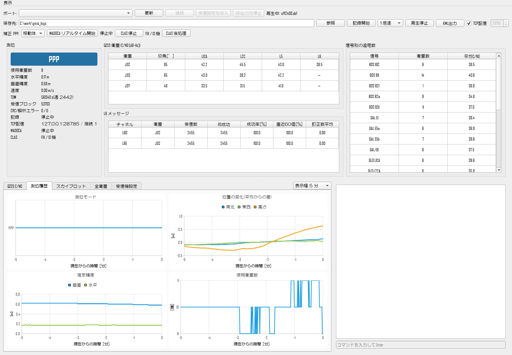
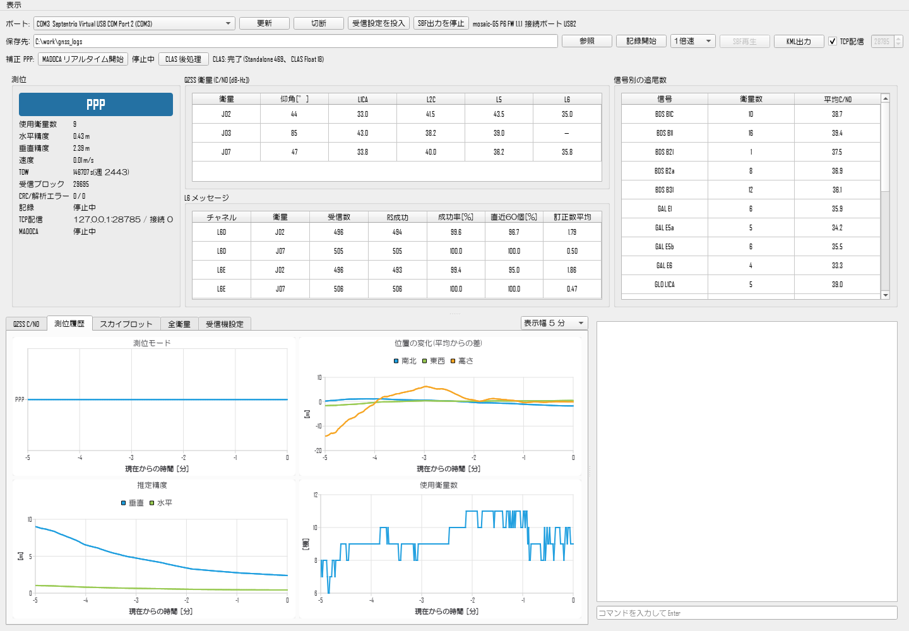
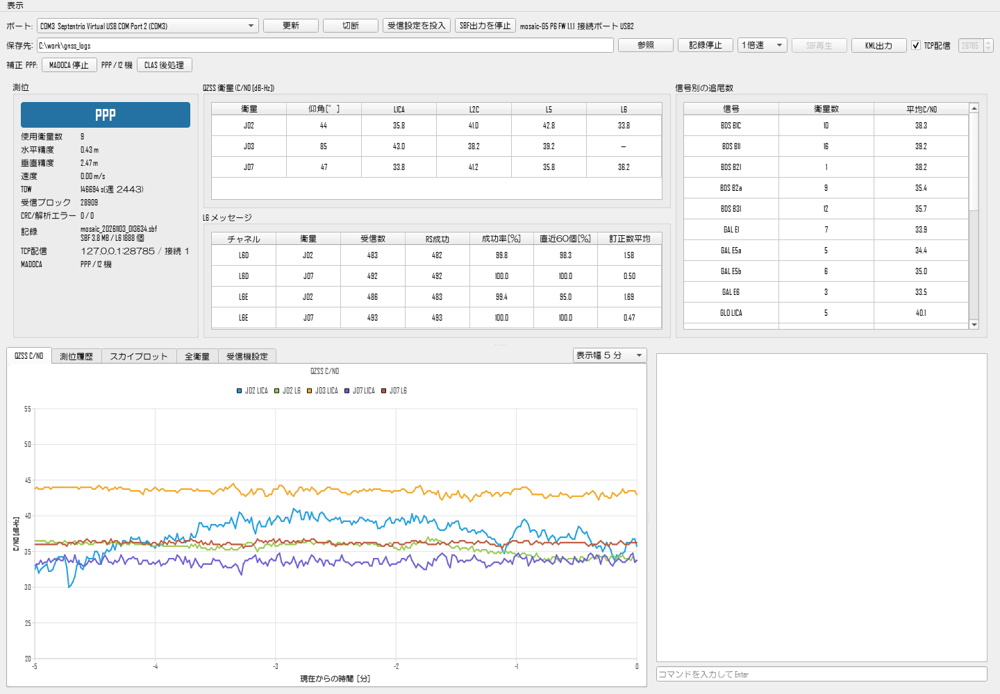
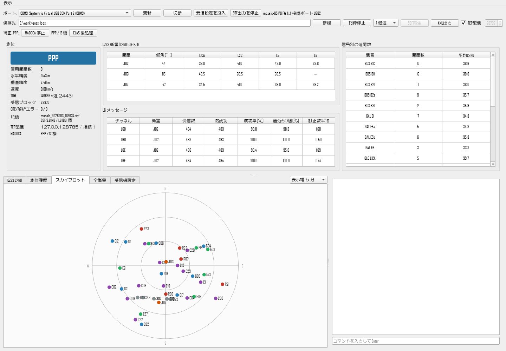

# mosaic_gnss_recorder 操作マニュアル

Septentrio mosaic 受信機(mosaic-G5 など)を USB で接続し、測位状況を見ながらログを保存するツールです。
受信機内部の測位(単独・SBAS・Galileo HAS PPP・RTK)に加えて、QZSS の補強信号を使う
**MADOCA-PPP(リアルタイム)** と **CLAS(リアルタイム・後処理)** を、このツールから実行できます。

## 1. インストール

1. Septentrio の **RxTools** を、USB Driver を含めてインストールします。
   受信機の USB ドライバと、CLAS の後処理で使う `sbf2rin.exe` が入ります。
2. `mosaic_gnss_recorder_Setup.exe` を実行します。管理者権限は不要です。
   スタートメニューに mosaic_gnss_recorder が追加されます。
3. 既定の保存先は「ドキュメント\mosaic_gnss_recorder」です。画面の「保存先」で変更できます。

MADOCA-PPP と CLAS の測位エンジン(MALIB、CLASLIB)はインストーラに同梱されています。別途の準備は要りません。

## 2. 画面の構成

| 場所 | 内容 |
|---|---|
| 1 行目 | ポートの選択、接続/切断、受信設定の投入、SBF 出力の停止。右側に機種・FW・接続ポート |
| 2 行目 | 保存先、記録開始/停止、SBF 再生、KML 出力、TCP 配信 |
| 3 行目(補正 PPP) | 移動体 / 静止の選択、MADOCA / CLAS リアルタイムの開始/停止と状態、CLAS 後処理 |
| 左の「測位」欄 | 受信機の測位モード(色付き)、衛星数、推定精度、記録・TCP 配信・MADOCA・CLAS の状態 |
| 中央・右の表 | QZSS 衛星の C/N0、L6 メッセージの受信状況、信号別の追尾数 |
| 下段のタブ | QZSS C/N0、測位履歴、スカイプロット、全衛星、受信機設定 |
| 右下 | 受信機とのコマンドのやり取り。下の欄から任意のコマンドを送れる |

緯度経度と地図は、「表示」メニューで ON にするまで表示しません。

## 3. 基本の操作(接続して記録する)

1. 受信機を USB で接続し、ポートで **Virtual USB COM Port 1 または 2** を選んで [接続] を押します。
   機種と FW を読み取り、受信機設定タブに現在の設定を表示します。この時点では受信機の設定は変えません。
2. [受信設定を投入] を押します。記録に必要な出力を設定します(送るコマンドは README を参照)。
   L6 に対応する受信機では QZSS L6 の追尾と、L6D / L6E の出力も設定します。
3. 保存先を確認して [記録開始] を押します。
4. 終わったら [記録停止]、[SBF出力を停止]、[切断] の順に押します。

**受信機の設定は Current だけを変更し、Boot には保存しません。** 電源を入れ直すと元の設定に戻ります。

## 4. 測位モードの使い方

| 測位モード | 計算する場所 | 必要なもの | 位置が出るまで | 精度の目安 |
|---|---|---|---|---|
| 単独測位 | 受信機 | なし | 数十秒 | 数 m |
| SBAS | 受信機 | なし(みちびき/MSAS の L1S を受信) | 数十秒 | 1〜2 m 程度 |
| Galileo HAS PPP | 受信機 | HAS 対応の受信機(Capabilities に PPPGalileoHAS-SIS) | 数分〜十数分 | 数十 cm〜1 m 程度 |
| RTK | 受信機 | 基準局の補正データ(NTRIP など)を受信機へ入力 | 数十秒〜数分 | 数 cm |
| MADOCA-PPP(リアルタイム) | このツール(MALIB) | QZSS L6 に対応する受信機 | 数分(FIX は十数分以上) | 数十 cm(FIX 後は 10 cm 程度) |
| CLAS(リアルタイム) | このツール(CLASLIB) | QZSS L6 に対応する受信機 | 1〜数分 | 数 cm(FIX 時) |
| CLAS(後処理) | このツール(CLASLIB) | QZSS L6 に対応する受信機、RxTools | 記録後に処理(数十秒) | 数 cm(FIX 時) |

精度は上空の見通し・アンテナ・時間帯で大きく変わります。表の値は開けた場所で静止したときの目安です。
同じ時間に複数の方式を比べたいときは、受信機で HAS PPP を動かしながら、このツールで MADOCA と CLAS を計算できます。

### 4.1 受信機の測位モードを切り替える

単独・SBAS・HAS PPP・RTK は、受信機の中で計算します。「受信機設定」タブで切り替えます。

1. [接続] すると現在値が読み込まれます。読み直すときは [現在値を読み込む] を押します。
2. 左上の「やりたい測位を選択」から目的の測位を選ぶと、関係する項目が選択済みになります。
   **選んだだけでは受信機に送りません。**
3. 必要なら項目を個別に変え、[変更を送信] を押します。送るコマンドの一覧を確認してから送信し、値を読み直します。
4. 左の「測位」欄の色付きの表示が、受信機の測位モードです(Standalone、SBAS、PPP、RTK Fixed など)。

衛星系や信号を変えると、追尾がいったん止まって再捕捉が始まります。

#### 単独測位

「単独測位」を選びます。測位モードが `StandAlone` だけになります。補強を使わない基準として比べるときに使います。

#### SBAS

「SBAS」を選びます。測位モードが `StandAlone+SBAS` になります。
SBAS 補正の項目で、使う SBAS 衛星(auto など)を選べます。

#### Galileo HAS PPP

「Galileo HAS PPP」を選びます。測位モードが `StandAlone+SBAS+PPP` になり、Galileo の E1・E5a・E5b・E6 を追尾して、
E6(HAS の補正)を測位に使う設定になります。

- HAS に対応していない受信機では、PPP を選んでも PPP になりません(Capabilities に PPPGalileoHAS-SIS があるか確認してください)
- 「PPP」と表示されても、最初は収束していません。水平精度(推定精度)が下がるまで数分〜十数分待ちます
- 推定精度は実際の誤差より小さく出ることがあります。精度の評価には RTK などの基準位置を使ってください
- 「Galileo HAS PPP + L6 記録」は、HAS PPP に加えて QZSS L6 も追尾します。
  MADOCA / CLAS と同時に比べるときはこちらを選びます

#### RTK

「RTK(補正データの入力が別途必要)」を選びます。測位モードが `StandAlone+SBAS+DGNSS+RTK` になります。

RTK には基準局の補正データ(RTCM 3)が必要です。このツールは補正データを送りません。
例えば、このツールで Virtual USB COM Port 2 に接続し、Septentrio の RxControl で Port 1 から NTRIP の補正データを
受信機へ入れると、記録と RTK を同時に行えます(COM ポートは 1 つのアプリしか開けません)。

RTK が Float のまま FIX しないときは、次を確認してください。

- 測位モードに PPP が含まれていない(HAS PPP と RTK を同時に有効にしない)
- 静止して使うなら、受信機ダイナミクスを Static にする
- 設定を変えたあと、測位フィルタをリセットする(コマンド欄で `exeResetNavFilter,PVT`)

### MADOCA / CLAS の「移動体 / 静止」

「補正 PPP」の行の左端で、このツールが計算する MADOCA / CLAS の設定を選びます。
受信機の測位(「受信機設定」タブの受信機ダイナミクス)とは別の設定です。

| 選択 | MADOCA | CLAS | 向いている使い方 |
|---|---|---|---|
| 移動体 | 動的 PPP(位置を毎エポック推定) | 車の加減速に追従する設定。C/N0 の低い衛星も使う。Float が 120 秒続いたらフィルタをやり直す | 車・人など動くもの |
| 静止 | 静的 PPP(位置を 1 点として推定。収束が速い) | CLASLIB の静止観測向けの設定。Float が 15 秒続いたらやり直す(誤った FIX から早く抜ける) | 三脚などで動かさない観測 |

- 開始したときの選択を使います。実行中に変えたときは、止めて開始し直してください
- [CLAS 後処理] もこの選択に従います
- 静止の観測で「移動体」を選んでも測位はできますが、誤った FIX から抜けるのが遅くなることがあります。
  動くもので「静止」を選ぶと MADOCA は正しく測位できません

### 4.2 MADOCA-PPP(リアルタイム)

QZSS の L6E で配信される MADOCA-PPP の補正を使って、このツールが PPP を計算します。
受信機の測位モードとは独立に動くので、受信機で HAS PPP を動かしたまま比べられます。

1. [接続] → [受信設定を投入] を押します。L6E と、放送暦を作るための航法メッセージの生データ(RawNavBits)が出力されます。
2. 必要なら [記録開始] を押します(MADOCA の解は記録しなくても保存されます)。
3. 「移動体 / 静止」を選び、[MADOCA リアルタイム開始] を押します。TCP 配信が止まっていれば自動で開始し、測位エンジンがそれを入力にします。
4. 「補正 PPP」の行と「測位」欄の MADOCA に、解の状態と衛星数が出ます。

| 表示 | 意味 |
|---|---|
| 解なし / 0 機 | 放送暦や補正がまだ揃っていない。開始から 1〜2 分はこの状態 |
| PPP / n 機 | MADOCA-PPP の解(Float)。収束まで数分〜十数分 |
| FIX / n 機 | 整数アンバイギュイティが解けた解(PPP-AR) |

- 解は保存先の `madoca_日時.pos`(RTKLIB の pos 形式)に 1 秒ごとに書かれます。設定は同じ名前の `.conf` です
- 「表示」メニューで地図を ON にすると、受信機の軌跡(青)に MADOCA の軌跡(緑)を重ねて表示します
- 止めるときは [MADOCA 停止] を押します。アプリを閉じても止まります
- L6 に対応していない受信機(Capabilities に QZSL6 が無いもの)では使えません
- L6 の受信状況は中央の「L6 メッセージ」表で確認できます。L6E の RS 成功率が低いと補正が途切れます
- MADOCA-PPP は補正を数十分続けて受けて収束します。走行中など L6E が途切れがちな状況では収束せず、誤差は m 級のままです
  (11/03 の走行では、L6E を欠けなく使えた時間が約 4 割で、水平誤差は中央値 2 m 前後でした)

### 4.3 CLAS(リアルタイム)

QZSS の L6D で配信される CLAS(センチメータ級測位補強サービス)の補正を使って、このツールが PPP-RTK を計算します。
MADOCA と同じく受信機の測位モードとは独立に動き、MADOCA と同時にも動かせます。

1. [接続] → [受信設定を投入] を押します。L6D と航法メッセージが出力されます。
2. 必要なら [記録開始] を押します(CLAS の解は記録しなくても保存されます)。
3. 「移動体 / 静止」を選び、[CLAS リアルタイム開始] を押します。TCP 配信が止まっていれば自動で開始し、測位エンジンがそれを入力にします。
4. 「補正 PPP」の行と「測位」欄の CLAS に、解の状態と衛星数が出ます。

| 表示 | 意味 |
|---|---|
| 解なし / 0 機 | 放送暦や補正がまだ揃っていない |
| 単独 / n 機 | CLAS 補正を待っている、または使える衛星が足りない |
| Float / n 機 | CLAS の解(アンバイギュイティ未決定)。数十 cm〜1 m 程度 |
| FIX / n 機 | アンバイギュイティが解けた解。数 cm |

- 解は保存先の `clas_日時.pos`(RTKLIB の pos 形式。Q=1 が FIX、2 が Float、5 が単独)に書かれます。設定は同じ名前の `.conf` です
- 「表示」メニューで地図を ON にすると、CLAS の軌跡を紫で重ねて表示します(MADOCA は緑)
- 止めるときは [CLAS 停止] を押します。アプリを閉じても止まります
- **解は約 5 秒遅れて出ます。** CLAS の補正は 5 秒単位で少しずつ届くので、観測を 5 秒待たせ、時刻の揃った補正で測位しています
  (受けた直後に測位すると、走行中の FIX の誤差が数倍になりました)
- L6D は受信できた QZSS 衛星のうち 1 機を選んで使います(30 秒途切れたら別の衛星に切り替えます)。
  RS 復号に失敗したフレームがあると、その補正の区切り(5 秒)の残りは使いません
- 放送暦は、航法メッセージの生データ(GPSRawCA など)と、受信機が解読した GPSNav / GALNav / QZSNav のどちらからでも作ります
- CLAS の補正は日本とその周辺が対象です

開けた場所で静止して記録した約 1 時間 40 分のデータ(10/31)では、全体の 98% が FIX し、CLASLIB で後処理した結果との差は中央値で 2 cm でした。
走行(11/03、RTK を基準に評価、「移動体」の設定)では、FIX の水平誤差は中央値 0.15 m、95% で 1.0 m でした。走行中は L6 が途切れやすく(RS 成功率 40〜70%)、FIX が短時間で外れます。
開始直後や、遮蔽の多い場所を抜けた直後は、誤った FIX(数十 cm〜1 m ずれたまま FIX が続く)になることがあります。受信機の測位や MADOCA と比べて、数十 cm 以上ずれたまま FIX が続くときは [CLAS 停止] → [CLAS リアルタイム開始] でやり直してください。

### 4.4 CLAS(後処理)

QZSS の L6D で配信される CLAS(センチメータ級測位補強サービス)の補正を使って、記録済みの SBF を PPP-RTK で処理します。

1. CLAS に使うデータは、[受信設定を投入] をしてから記録したものにしてください(L6D と放送暦が必要です)。
2. 「移動体 / 静止」を選び、[CLAS 後処理] を押して SBF を選びます(複数選ぶと時刻順につないで処理します)。
3. 「補正 PPP」の行に処理の段階が出ます。1 時間程度のデータなら 1 分以内に終わります。

4. 終わると、FIX・Float・単独のエポック数が表示され、SBF と同じフォルダに次のファイルができます。

| ファイル | 内容 |
|---|---|
| `元の名前_clas.pos` | CLAS の解(RTKLIB の pos 形式。Q=1 が FIX、2 が Float、5 が単独) |
| `元の名前_clas.kml` | 解を CLAS FIX / CLAS Float / Standalone に色分けした KML |
| `元の名前_clas_work\` | 途中のファイル(RINEX、L6D、設定) |

上の画面は、上空の見通しが悪い場所で 8 分だけ記録した例で、FIX していません(単独 469、Float 18 エポック)。
開けた場所で 1 時間以上記録したデータでは、ほぼ全エポックが FIX しました。

- CLAS は収束に時間がかかることがあります。10 分以上、できれば開けた場所で記録してください
- 記録の途中から始めたファイルだけを処理すると、最初の放送暦が足りず、しばらく単独測位(Q=5)になることがあります
- CLAS の補正は日本とその周辺が対象です
- RINEX への変換に RxTools の `sbf2rin.exe` を使います。見つからないときはエラーになります

## 5. その他の機能

### 測位履歴・C/N0・スカイプロット

下段のタブで、測位モード・位置の変化・推定精度・衛星数の時系列(測位履歴)、QZSS の C/N0、衛星配置を確認できます。
右上の「表示幅」で 1 分〜全期間を選べます。

### KML 出力

[KML出力] で記録済みの SBF を選ぶと、受信機の測位結果を測位モードで色分けした KML を作ります。
Google Earth などで、どこで PPP が途切れたかなどを確認できます。

### TCP 配信

[TCP配信] にチェックを入れると、受信した SBF ブロックをこの PC 内(127.0.0.1、既定ポート 28785)へ配信します。
RTKLIB 系のソフトで「TCP Client、形式 SBF」として受けると、記録しながら別のソフトで処理できます。
MADOCA / CLAS リアルタイムもこの配信を使っています。

### SBF 再生

[SBF再生] で記録済みの SBF を選ぶと、受信機なしで画面の動きを再現できます。再生中も TCP 配信と MADOCA / CLAS リアルタイムを使えます。

## 6. 保存されるファイル

| ファイル | 内容 |
|---|---|
| `mosaic_日時.sbf` | 受信機の生データ(CRC 検査を通った SBF ブロック)。sbf2rin で RINEX に変換できる |
| `mosaic_日時_pvt.csv` | 受信機の測位結果 |
| `mosaic_日時_L6D_Jnn.l6` / `_L6E_Jnn.l6` | RS 復号に成功した L6 メッセージ(CLAS / MADOCA 用) |
| `madoca_日時.pos` / `.conf` | MADOCA リアルタイムの解と設定 |
| `clas_日時.pos` / `.conf` | CLAS リアルタイムの解と設定 |
| `*_clas.pos` / `*_clas.kml` | CLAS 後処理の解と KML |

**pos・csv・kml には位置情報が含まれます。** 共有するときは注意してください。

## 7. ライセンス

MADOCA-PPP の計算には MALIB(JAXA、BSD 2-Clause)、CLAS の計算には CLASLIB(内閣府 QZSS 事業推進室ほか、
BSD 2-Clause と追加条項)を使っています。ライセンス文はインストール先の `_internal\engines\licenses\` にあります。
